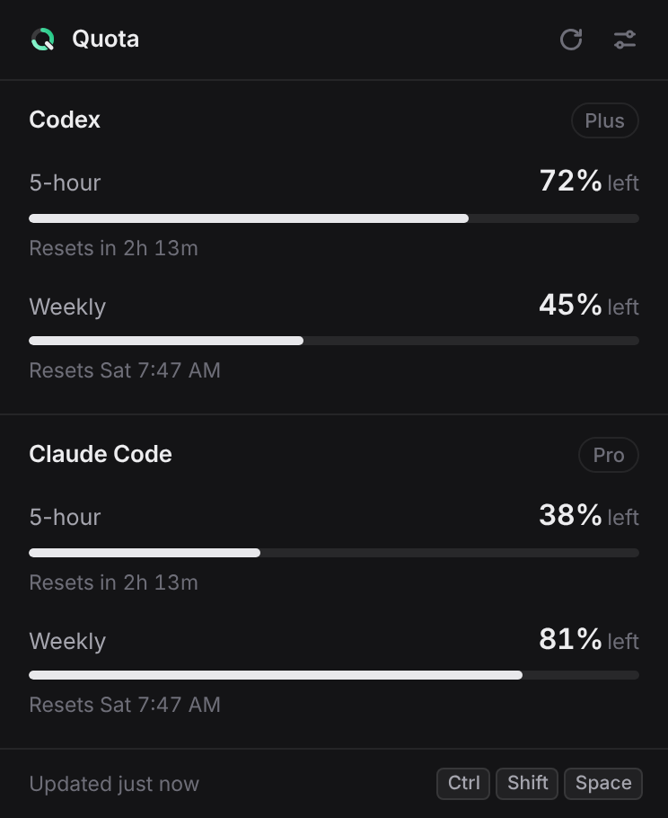

# Quota

**Your AI usage. One shortcut away.**

Quota is a small Windows tray app that shows how much of your **Codex**, **Claude Code** and
**Antigravity** subscription usage is left. Press <kbd>Ctrl</kbd>+<kbd>Shift</kbd>+<kbd>Space</kbd> from any app
and a compact overlay shows the remaining percentage and reset time for your 5-hour and weekly
limits. Press it again, hit <kbd>Esc</kbd>, or click elsewhere to dismiss it.

<p align="center">
  
  <br><sub>The overlay in dark mode (sample data from the UI preview).</sub>
</p>

## Why

Codex, Claude Code and Antigravity all meter subscription use in rolling 5-hour and weekly windows, but
finding out where you stand means opening a terminal, running a command, or digging through a
web page. Quota keeps that one number a keystroke away, without API keys and without changing how
you sign in to any of them.

## Features

- **One global shortcut** toggles the overlay on the monitor your cursor is on. Customizable,
  with conflict detection. Click anywhere outside it, or press <kbd>Esc</kbd>, to dismiss it.
- **Put it where you like.** Drag the overlay anywhere; it reopens in that spot, on that
  monitor, until you reset it in Settings.
- **Remaining %, never overstated.** Percentages are rounded down; a bar and a reset countdown
  ("Resets in 2h 14m", "Resets Thu 9:00 AM") sit under each limit.
- **Honest about freshness.** Data that couldn't be refreshed is dimmed and says why ("Couldn't
  refresh · showing data from 2h ago"). A limit that reset since the last check says so instead
  of showing old numbers. A limit a provider doesn't report shows "Not reported", never a guess.
- **Lives in the tray.** No taskbar button, single instance, optional launch at startup, and a
  tray tooltip with what's left.
- **Light and dark themes** that follow Windows by default; DPI-aware on mixed-scaling monitors.
- **Light on resources.** Native Rust core with the system WebView2; no Electron.

## Install

1. Download the latest release from
   [**Releases**](https://github.com/kohbgk/quota/releases/latest):
   - `Quota_x.y.z_x64-setup.exe`: installer (per-user, no admin needed). Recommended.
   - `Quota_x.y.z_x64-portable.exe`: a single executable you can run from anywhere.
   - `SHA256SUMS.txt`: checksums for both.
2. Run it. Quota starts in the system tray and shows a one-time hint.
3. Press <kbd>Ctrl</kbd>+<kbd>Shift</kbd>+<kbd>Space</kbd>.

Requirements: Windows 10 or 11 (x64). Install and sign in to the tools you want to track:

- **Codex**: the [Codex CLI](https://github.com/openai/codex), signed in with ChatGPT
  (`codex login`).
- **Claude Code**: [Claude Code](https://docs.anthropic.com/en/docs/claude-code), signed in
  with a Claude subscription (Pro or Max).
- **Antigravity**: the [Antigravity](https://antigravity.google) app, signed in with your Google
  account. Optional: Quota hides Antigravity when it isn't installed.

## Keyboard

| Key | Action |
| --- | --- |
| <kbd>Ctrl</kbd>+<kbd>Shift</kbd>+<kbd>Space</kbd> | Show or hide Quota (change it in Settings) |
| <kbd>Esc</kbd> | Hide the overlay |
| <kbd>R</kbd> or <kbd>F5</kbd> | Refresh now |
| <kbd>Ctrl</kbd>+<kbd>,</kbd> | Open Settings |

Left-click the tray icon to toggle the overlay; right-click it for Refresh, Settings, and Quit.

## How Quota gets your usage

Quota uses the sign-ins you already have. It never asks for a password or API key, and it never
logs, stores, or sends your credentials anywhere except to the provider they belong to.

### Codex

Read through the official `codex app-server` interface: Quota starts it in the background and
asks for your account's rate limits (`account/rateLimits/read`). Codex manages its own ChatGPT
sign-in; Quota never reads it. Quota finds `codex` on your `PATH` and in the usual npm, WinGet,
Scoop, Volta, pnpm, and Bun locations, or you can set a custom path in Settings.

### Claude Code

Anthropic doesn't offer an official API for subscription limits, so Quota offers two sources.
**Both are off until you turn one on.** Quota asks the first time you open it.

**Use Claude Code's sign-in** (recommended)

Asks Anthropic for your plan's 5-hour and weekly usage, anytime.

- Uses an undocumented Anthropic endpoint, so it may stop working if Anthropic changes it.
- The sign-in Claude Code saved on this PC (`%USERPROFILE%\.claude\.credentials.json`, or
  `CLAUDE_CONFIG_DIR`) is read only when needed, sent only to `api.anthropic.com`, and never
  stored or logged by Quota.
- Quota never renews the sign-in. If it expires, opening Claude Code renews it.

**Status line bridge**

Uses the rate limits Claude Code reports to status line commands, Anthropic's documented
interface. Updates only while you use Claude Code.

- Turning it on registers Quota as Claude Code's status line command in
  `~\.claude\settings.json`; the status line shows the model and usage left.
- If you already have a custom status line, Quota won't replace it.
- Turning it off, or uninstalling Quota, restores the default.

### Antigravity

Google doesn't offer an official way to read Antigravity quotas. **This source is off until you
allow it.** Quota asks the first time it finds Antigravity.

**Read quota from the Antigravity app**

While Antigravity is open, its language server answers on `127.0.0.1`. Quota asks it for the
same quota summary Antigravity shows in its own settings: the 5-hour and weekly limits for each
model group ("Gemini", "Claude and GPT").

- Uses Antigravity's undocumented local interface, so it may stop working after an Antigravity
  update.
- Everything stays on your PC. Quota reads the per-session key the app passes to its own
  language server, sends it only to that server on `127.0.0.1`, and never stores or logs it.
- When Antigravity is closed, Quota shows the last numbers it read, labelled with their age.

## Settings

Open Settings from the overlay's sliders button, the tray menu, or <kbd>Ctrl</kbd>+<kbd>,</kbd>.

| Section | Options |
| --- | --- |
| Overlay | Show 5-hour limits, show weekly limits (at least one stays on); show Codex, Claude Code, Antigravity (at least one stays on) |
| Shortcut | Record a new shortcut, or reset to the default |
| Providers | Custom path to `codex.exe`; choose the Claude Code source(s); allow reading Antigravity's quota |
| General | Launch at startup; hide when clicking outside; reset the overlay's position; theme (System, Light, Dark); refresh every 2, 5, or 15 minutes, or only when opened |

Quota also refreshes when you open the overlay if its data is more than a minute or two old, and
backs off automatically when a provider is unavailable or asks it to slow down.

Settings and the last retrieved usage (no credentials) are kept in
`%APPDATA%\com.kohbgk.quota\`.

## Known limitations

- **The Claude sign-in source relies on an undocumented endpoint.** Anthropic may change or
  remove it at any time. The status line bridge uses a documented interface but only updates
  while Claude Code is in use.
- **The status line bridge won't replace a custom status line.** If you already have one, use
  the sign-in source instead.
- **Antigravity relies on an undocumented local interface,** and only updates while the
  Antigravity app is open. A bucket Antigravity reports without a clear 5-hour or weekly window
  is left out rather than guessed.
- **Codex may not report every window.** Some plans report only a weekly limit; Quota shows the
  other as "Not reported".
- **The portable exe needs WebView2.** It's built into Windows 11 and most Windows 10 installs;
  the installer adds it if it's missing, the portable build does not.
- **Builds aren't code-signed yet.** Windows SmartScreen may warn on first run: choose
  *More info* → *Run anyway*. Compare the file against `SHA256SUMS.txt` if you want to verify it.
- Windows only.

## Build from source

You need [Node.js](https://nodejs.org/) 22+, [Rust](https://rustup.rs/) (stable, MSVC), and the
[Tauri prerequisites for Windows](https://tauri.app/start/prerequisites/).

```powershell
git clone https://github.com/kohbgk/quota
cd quota
npm ci
npm run tauri dev        # run with hot reload
npx tauri build          # installer in src-tauri\target\release\bundle\nsis\
```

Checks (run before pushing; CI runs the same on Windows):

```powershell
npm test; npm run typecheck
cd src-tauri; cargo test; cargo clippy --all-targets -- -D warnings
```

To work on the UI in a browser without the Rust side, run `npm run dev` and open
`http://localhost:1420/?scenario=both` (other scenarios: `loading`, `low`, `stale`, `missing`,
`none`, `consent`, `signedout`, `errors`, `statusline`, `waiting`, `first-run`, `light`, …; see
`src/dev/mock.ts`). Settings preview: `/settings.html?scenario=both`. Preview data is mock data
and is excluded from production builds.

### Project layout

```
src-tauri/src/   Rust core: refresh engine, providers, tray, overlay window, shortcut, settings
src/             TypeScript UI (no framework): overlay.ts, settings.ts, lib/ (view model, formatting)
.github/         CI (Windows test + build) and the release workflow
```

## Releases

Releases are built by GitHub Actions. Keep the version in sync in `src-tauri/tauri.conf.json`,
`src-tauri/Cargo.toml`, and `package.json`, add a `## [x.y.z]` section to
[`CHANGELOG.md`](CHANGELOG.md) (it becomes the release notes), then tag:

```bash
git tag v0.1.0 && git push --tags
```

Or run the **Release** workflow on `main` from the Actions tab, which tags `main` as
`v<version>` for you. The release workflow checks that the tag matches the app version, runs the tests, builds on
Windows, and publishes the installer, the portable exe, and `SHA256SUMS.txt` to a GitHub release.
Before tagging, run the manual checklist in [`docs/TESTING.md`](docs/TESTING.md).

## License

[MIT](LICENSE)
